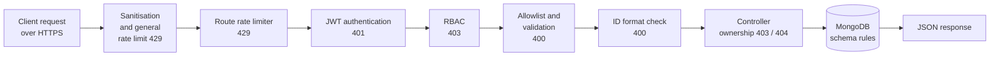
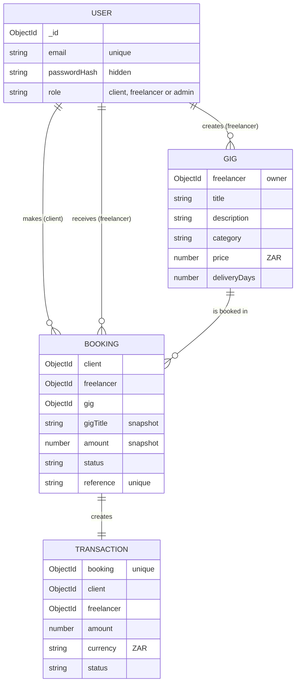

<div align="center">

# 💼 HustleHub+

### A secure freelance marketplace built on the MERN stack

**INSY7314 · Part 3 — DevSecOps, Monitoring and Finalisation · Group 7**


</div>

---

HustleHub+ is a secure freelance marketplace platform that allows freelancers to advertise their services and clients to browse and book them. Beyond standard marketplace functionality, the platform records a financial transaction for every booking and provides freelancers with an indication of income earned and estimated tax obligations.

Because the platform processes sensitive information — user credentials, transactional records and income-related data — security has been treated as a primary design concern from the outset rather than added afterward. In Part 3, that security is checked automatically: every push runs tests, linting, dependency audits, secret scanning and static code analysis.

| Part | Focus | Status |
|:----:|-------|:------:|
| **1** | Secure backend foundations | ✅ Complete |
| **2** | Full-stack application development | ✅ Complete |
| **3** | DevSecOps, monitoring and finalisation | ✅ **This submission** |

## 📑 Table of contents

- [What changed since Part 2](#what-changed)
- [Features](#features)
- [System overview](#system-overview)
- [Intended users](#intended-users)
- [Architecture](#architecture)
- [Security features overview](#security-features-overview)
- [Backend structure](#backend-structure)
- [Request flow](#request-flow)
- [Database and data models](#database-and-data-models)
- [Security implementation](#security-implementation)
- [Tax calculation](#tax-calculation)
- [Own security features](#own-security-features)
- [Logging and monitoring](#logging-and-monitoring)
- [API endpoint reference](#api-endpoint-reference)
- [Setup](#setup)
- [Docker](#docker)
- [Testing](#testing)
- [CI/CD pipeline](#cicd-pipeline)
- [Static code analysis](#static-code-analysis)
- [Dependency and secret scanning](#dependency-and-secret-scanning)
- [Security review](#security-review)
- [Screenshots](#screenshots)
- [Demonstration video](#demonstration-video)
- [Team and contributions](#team-and-contributions)
- [References](#references)

<a id="what-changed"></a>
## 🆕 What changed since Part 2

| Area | Part 2 | Part 3 |
|------|--------|--------|
| **Gig management** | Freelancers could create and delete gigs | Freelancers can also **edit** their gigs from the dashboard *(Part 2 feedback)* |
| **CI/CD** | None | GitHub Actions pipeline that tests, lints, builds and security-scans the backend and frontend on every push |
| **Backend tests** | Postman and Newman only | 127 automated Jest tests that run without a database, plus the existing Postman collections |
| **Frontend tests** | 14 tests | 29 tests, including the edit gig flow and protected browse routes |
| **Static analysis** | None | CodeQL (security-extended queries) and ESLint with `eslint-plugin-security` |
| **Dependency security** | Not checked | `npm audit` on both apps; all critical, high and moderate vulnerabilities fixed |
| **Secret scanning** | Not checked | Gitleaks on every push, plus a scan of the full git history |
| **Rate limiting** | Login, registration and booking only | A general limit on every API route as well |
| **Sanitisation** | `$` keys, dotted keys, `<`, `>` and `$` characters | Also drops `__proto__`, `constructor` and `prototype` keys (prototype pollution), found by CodeQL |
| **Browse pages** | Shown to logged-out visitors, who then saw an API error | Require a login, matching the API, with a message on the login page |
| **Code structure** | Express app and server start-up in one file | `app.js` builds the app and `server.js` starts it, so tests can load the app without MongoDB or certificates |
| **Frontend code quality** | 5 existing lint errors | Lint is clean; the saved session is read once on load, and corrupted saved data no longer crashes the app |

> ✏️ **KAITLYN:** add rows for the tax calculation (SARS 2026/27 brackets, expenses), the Income & Tax dashboard and Docker.
>
> ✏️ **NIKKITA:** add rows for logging, account lockout, the security audit log and JWT revocation.

> [!NOTE]
> **Part 2 feedback addressed**
> - **Edit gigs from the interface:** the backend already supported updating gigs, but the dashboard had no way to do it. Each gig card on the freelancer dashboard now has an **Edit** button that opens the form filled with the gig's current details. **Save Changes** sends the update to the existing `PATCH /api/gigs/:id` endpoint, and the list refreshes with a success message. Validation and server errors (for example, editing someone else's gig) are shown inside the form. See [Frontend testing](#frontend-testing) for the tests.

---

<a id="features"></a>
## ✨ Features

### Backend

- User registration and login backed by MongoDB, with hashed passwords and JWT authentication
- Gig management — freelancers can create, view, update and delete their own gigs
- Gig browsing with an optional category filter, and a single-gig view
- Booking a gig with a simulated confirmation reference (no real payment is processed)
- Automatic transaction record for every booking, linked to both the client and the freelancer
- Booking history for clients (bookings made) and freelancers (bookings received)
- Income summary for freelancers, including an estimated tax figure
- Rate limiting on every API route, with stricter limits on authentication and booking
- Seed script that creates demo accounts, gigs, bookings and transactions

> ✏️ **KAITLYN:** update the income bullet for the new tax calculation and expenses.
>
> ✏️ **NIKKITA:** add bullets for logging, account lockout, the audit log and logout with token revocation.

### Frontend

- Registration and login pages, with client-side validation and clear, non-technical error messages
- Protected routes that redirect to login when signed out, and away from pages a user's role cannot access
- Gig browsing with an optional category filter, and a gig detail page — both require a login, and logged-out visitors are told *"Please log in or register to browse gigs."*
- A one-click booking flow with a simulated confirmation screen showing the booking reference and amount
- A client bookings page showing booking history
- A freelancer dashboard with three tabs: my gigs (create, **edit** and delete), bookings received, and an income summary with the estimated tax figure
- An admin page with tables for all users, all gigs and all bookings
- Invalid input is caught before a request is sent (e.g. a gig price must be a positive number, a title must be at least 3 characters), and every API error is shown as a plain, user-facing message — raw server errors, stack traces and status codes are never displayed in the UI

> ✏️ **KAITLYN:** update the income tab bullet for the Income & Tax dashboard and its charts.

---

<a id="system-overview"></a>
## 🧭 System overview

HustleHub+ is built on the MERN stack — MongoDB, Express, React and Node.js. The MERN architecture was selected because it allows the development team to use JavaScript across both the frontend and backend, supporting consistent development conventions and data handling across the application.

The system supports the full marketplace flow: authentication, gig management, bookings, transaction recording and income tracking. Data is stored in MongoDB Atlas and accessed through Mongoose. In Part 3, a GitHub Actions pipeline checks every change automatically before it is merged.

<a id="intended-users"></a>
## 👥 Intended users

| Role | Description | Key capabilities |
|------|-------------|------------------|
| **Client** | A user looking to hire freelance services | Browse gigs, book gigs, view their own booking history |
| **Freelancer** | A user offering services on the platform | Create, edit and delete their own gigs, view bookings received, view income and estimated tax |
| **Admin** | Platform administrator | Oversee platform activity (see [Role-based access control](#role-based-access-control)) |

Public registration only allows the `client` and `freelancer` roles, so an admin account cannot be self-registered. Admin accounts are created only through the seed script.

<a id="architecture"></a>
## 🏗️ Architecture


The React frontend communicates with the Express backend using a REST API with JSON over HTTPS. The backend connects to a MongoDB Atlas database.

All security-relevant logic sits inside the backend's **trust boundary**, before any data reaches the database. A trust boundary marks the point where data crosses from a less trusted context (the client) into a more trusted, controlled one (the server). Anything that arrives from the client — request bodies, URL parameters, query strings and tokens — is treated as untrusted until the backend has verified it.

> ✏️ **KAITLYN:** add a short note on how the stack runs in Docker (MongoDB, backend and frontend containers).

---

<a id="security-features-overview"></a>
## 🛡️ Security features overview

| Security feature | Introduced in |
|------------------|:-------------:|
| Password hashing with bcrypt | Part 1 |
| JWT authentication on all protected routes | Part 1 |
| HTTPS with a locally trusted certificate | Part 1 |
| Centralised, non-revealing error handling | Part 1 |
| Password hashes excluded from all database queries and API responses | Part 2 |
| Unique email enforced at database level | Part 2 |
| Resource ownership checks (users can only modify their own gigs) | Part 2 |
| Own-data-only endpoints (my gigs, my bookings, bookings received, income) | Part 2 |
| Mass assignment protection (owner and price taken from trusted sources) | Part 2 |
| ID format validation on URL parameters | Part 2 |
| Atomic booking and transaction creation | Part 2 |
| Rate limiting on login, registration and booking | Part 2 |
| JWT algorithm, issuer and audience validation | Part 2 |
| Role-based access control (RBAC) | Part 2 |
| Rejection of unexpected request fields | Part 2 |
| Input validation on every endpoint that accepts a body, and sanitisation of every request (NoSQL injection and XSS) | Part 2 |
| Security headers on API responses with Helmet and Content Security Policy | Part 2 |
| Prototype pollution protection in the sanitiser (found by CodeQL) | Part 3 |
| General rate limit on every API route (found by CodeQL) | Part 3 |
| Automated security tests, linting, dependency audit, secret scanning and static analysis on every push | Part 3 |

> ✏️ **KAITLYN:** add rows for Docker (non-root containers) and security headers on the frontend Nginx server.
>
> ✏️ **NIKKITA:** add rows for account lockout, admin unlock, the security audit log, JWT revocation on logout and cloud logging.

---

<a id="backend-structure"></a>
## 📁 Backend structure

| Folder / file | Responsibility |
|---------------|----------------|
| `app.js` | Builds and configures the Express app (middleware and routes). Never connects to the database or starts a server, so tests can load it safely |
| `server.js` | Loads `.env`, connects to MongoDB and starts the HTTPS server |
| `src/config` | Database connection setup |
| `src/routes` | Defines API endpoints and maps them to controllers and middleware |
| `src/controllers` | Handles request and response logic, including ownership checks |
| `src/models` | Mongoose schemas for users, gigs, bookings and transactions |
| `src/services` | Reusable logic such as password hashing and JWT handling |
| `src/middleware` | Authentication, authorisation, allowlist, sanitisation, validation, ID format checks, rate limiting and error handling |
| `src/utils` | Shared helpers, including the consistent `{ success, message }` response format |
| `scripts` | Development scripts, including the demo data seed script |
| `tests` | Jest tests for the middleware, services and registration controller |

Routes decide *where* a request goes, middleware decides *whether* it may proceed, controllers decide *what* happens to it, and models define and protect the stored data.

<a id="request-flow"></a>
## 🔄 Request flow



1. **Sanitisation** — every request body and query string is cleaned before any route runs
2. **General rate limit** — every `/api` route allows 300 requests per IP every 15 minutes; more are rejected with `429`
3. **Route rate limiting** — login and registration have a stricter IP limit, and bookings a per-user limit
4. **Authentication** — the JWT is verified; missing or invalid tokens are rejected with `401`
5. **Authorisation** — the user's role is checked against the route; unauthorised roles are rejected with `403`
6. **Allowlist and validation** — unexpected fields and invalid input are rejected with `400`
7. **ID validation** — on routes with an ID in the URL, malformed IDs are rejected with `400`
8. **Controller** — performs existence and ownership checks (`404` / `403`) and builds the data from trusted sources only
9. **Model** — Mongoose applies schema rules before anything is saved
10. **Response** — a consistent `{ success, message, ... }` JSON response is returned

> [!NOTE]
> The rate limiter's position depends on the route. Login and register apply their IP-based limiter before authentication, while booking applies its per-user limiter after authentication and the role check, because it counts requests by user ID from the verified token.

---

<a id="database-and-data-models"></a>
## 🗄️ Database and data models

HustleHub+ uses **MongoDB Atlas** with four collections, defined as Mongoose schemas in `src/models`.



All models use automatic `createdAt` and `updatedAt` timestamps.

> ✏️ **NIKKITA:** add the new fields and collections (for example `failedLoginAttempts` and `lockUntil` on User, the audit log and the token blacklist).

**💡 Design decisions**

- **Ownership is stored on every record.** Gigs store their `freelancer`, and bookings and transactions store both the `client` and the `freelancer`, so every request can be checked against the logged-in user.
- **Bookings store a snapshot of the gig.** The gig title and price are copied into the booking when it is made, so booking and transaction history stays accurate even if the gig is later edited or deleted.
- **One transaction per booking.** A unique index on `Transaction.booking` makes duplicate financial records impossible, so income can never be counted twice.
- **Schema-level limits.** Every field has type, length or range limits (e.g. price between R1 and R1,000,000, and a fixed list of categories), so invalid data is rejected at the database layer as a second line of defence.
- **Indexes on lookup fields.** `freelancer` and `client` fields are indexed to keep "my gigs", booking history and income calculations fast.

---

<a id="security-implementation"></a>
## 🔐 Security implementation

### Password storage

Passwords are hashed with bcrypt (10 salt rounds) before being saved, and plaintext passwords are never stored or logged. The `passwordHash` field is also marked `select: false` in the User model, so MongoDB never returns it unless the code explicitly requests it — which only happens during login, to verify the password. A `toJSON` rule additionally strips it from any user object sent in a response, so password hashes cannot leak through any endpoint, including ones that display user details such as bookings.

The demo accounts created by the seed script are hashed the same way.

### Authentication

On successful login, the backend issues a JWT containing only the user's ID and role, signed with a secret loaded from `.env`. Protected routes verify the token before any other processing, and login returns the same generic message for an unknown email or a wrong password, preventing user enumeration.

The token is signed and verified with three explicit settings rather than relying on defaults:

- **Algorithm (`HS256`)** is pinned on both signing and verification. Without this, a forged token could specify a different or weaker algorithm (including `none`) and potentially bypass signature checking — explicitly pinning and checking the algorithm closes that gap.
- **Issuer (`hustlehub-api`)** identifies this API as the token's source.
- **Audience (`hustlehub-client`)** identifies the HustleHub+ frontend as the token's intended recipient.

`jwt.verify()` is called with all three constraints, so a token that is correctly signed but has the wrong algorithm, issuer or audience is rejected before its payload is ever trusted — not just a malformed or expired token.

> ✏️ **NIKKITA:** add account lockout and JWT revocation on logout here, or link to [Own security features](#own-security-features).

### Role-based access control

An `authorize(...allowedRoles)` middleware runs after `authenticate` on every protected route. It reads the role from the verified JWT payload (never from the request body, which the client could tamper with) and rejects the request with `403` if that role is not in the route's allowed list. Because it runs immediately after authentication and before any booking-rate-limiting or controller logic, an unauthorised role is rejected as early as possible in the request lifecycle.

| Endpoint | Client | Freelancer | Admin |
|----------|:------:|:----------:|:-----:|
| `POST /api/gigs` | ❌ | ✅ | ❌ |
| `GET /api/gigs` | ✅ | ✅ | ✅ |
| `GET /api/gigs/mine` | ❌ | ✅ | ❌ |
| `GET /api/gigs/:id` | ✅ | ✅ | ✅ |
| `PATCH /api/gigs/:id` | ❌ | ✅ (own gigs only) | ❌ |
| `DELETE /api/gigs/:id` | ❌ | ✅ (own gigs only) | ❌ |
| `POST /api/bookings` | ✅ | ❌ | ❌ |
| `GET /api/bookings/mine` | ✅ | ❌ | ❌ |
| `GET /api/bookings/received` | ❌ | ✅ | ❌ |
| `GET /api/income/summary` | ❌ | ✅ | ❌ |
| `GET /api/admin/users` | ❌ | ❌ | ✅ |
| `GET /api/admin/gigs` | ❌ | ❌ | ✅ |
| `GET /api/admin/bookings` | ❌ | ❌ | ✅ |

RBAC controls which *role* can call an endpoint at all; the ownership checks described below separately control which *specific records* a freelancer can modify once they're past the role check.

On the frontend, the matching pages are wrapped in a `ProtectedRoute` component. This only improves the experience — logged-out visitors are sent to the login page instead of seeing an API error. The API is still the real enforcement point.

### Resource ownership and data access

RBAC controls *which kinds of user* can perform an action; ownership checks control *which specific records* a user can act on.

- **Update and delete** check that the gig's `freelancer` matches the user ID in the verified token. A missing gig returns `404`, and a gig owned by someone else returns `403`.
- **Own-data endpoints** (`/api/gigs/mine`, `/api/bookings/mine`, `/api/bookings/received` and `/api/income/summary`) have no user ID in the URL. They always use the ID from the token, so there is no way to request another user's data.
- **Booking your own gig is blocked** with `403` in the booking controller. Because only clients can book (see the table above) and each account has one role, a freelancer is already stopped by the role check first. The controller check is a second safety net.

### Mass assignment protection

Controllers never pass the request body straight into the database.

- **Gig creation and updates** copy only the allowed fields (`title`, `description`, `category`, `price` and `deliveryDays`). The `freelancer` owner is always taken from the token, so ownership cannot be set or transferred through a request. An update with none of these fields is rejected with `400`.
- **Bookings** read only `gigId` from the request. The client comes from the token, and the freelancer, title and price come from the stored gig, so a client cannot change the price they pay (e.g. sending `"amount": 1` is ignored).

### ID and query validation

- IDs in URLs must be exactly 24 hexadecimal characters, or the request is rejected with `400` before reaching the database.
- The gig `category` filter only accepts exact values from the allowed category list, so query strings cannot inject database operators into a search.

### Bookings, transactions and income

- **Atomic creation.** A booking and its transaction are saved inside a single MongoDB transaction — either both are saved or neither is — so a booking can never exist without its financial record.
- **Simulated confirmation.** Each booking receives a random, unguessable reference (e.g. `HH-7F3A9C21`) generated with Node's `crypto` module. No real payment is processed, as permitted by the brief.
- **Income tracking.** The income summary totals only the logged-in freelancer's `completed` transactions using a database aggregation.

> ✏️ **KAITLYN:** describe the estimated tax here, or link to [Tax calculation](#tax-calculation). The Part 2 flat 18% rate is replaced in Part 3.

### Rate limiting

Rate limiting is applied with `express-rate-limit`. Every API route has a general limit, and the most sensitive routes have stricter limits on top (Microsoft, 2026b):

| Endpoint | Limit | Counted per | Purpose |
|----------|-------|-------------|---------|
| Every `/api` route | 300 requests / 15 min | IP address | Stops one client from flooding the API and the database behind it |
| `POST /api/auth/register` | 10 requests / 15 min | IP address | Prevents mass fake-account creation |
| `POST /api/auth/login` | 10 requests / 15 min | IP address | Prevents brute-force password guessing |
| `POST /api/bookings` | 5 requests / 15 min | Authenticated user | Prevents booking and transaction flooding |

- The general limit was added in Part 3 after CodeQL reported that most routes had no rate limit (see [Static code analysis](#static-code-analysis)). It is applied once in `app.js`, before all routes. The health check at `/` is outside it.
- 300 requests is an **initial policy**, not a tuned production threshold. It can be changed with `API_RATE_LIMIT`, which only accepts a positive whole number — anything else (negative, decimal, `Infinity`, text) falls back to 300.
- The limiters run **before** validation, database lookups and password hashing, so blocked requests use almost no server resources.
- Booking limits are counted **per user ID** from the verified token, so one account cannot bypass the limit by changing IP address, and users sharing a network (e.g. campus Wi-Fi) do not block each other.
- When a limit is exceeded, the API returns `429 Too Many Requests` with a clear message, a `retryAfterSeconds` value, a `Retry-After` header and standard `RateLimit` headers:

```json
{
  "success": false,
  "message": "Too many authentication attempts. Please try again later.",
  "retryAfterSeconds": 870
}
```

> [!NOTE]
> The limits are counted per client IP address. The app does not set Express's `trust proxy` option, which is correct while the browser calls the API directly.
>
> ✏️ **KAITLYN:** if the Docker setup puts Nginx in front of the API, every user would appear as the Nginx container's IP and share one limit. In that case, set `app.set('trust proxy', 1)` (exactly one trusted proxy, never `true`) and note it here.

### Input validation and sanitisation

Input is handled in three layers. The first runs on every request. The other two run on each route that accepts a request body. Together, they follow OWASP's guidance to validate all input on the server (OWASP Foundation, 2021).

**1. Sanitisation (every request, before routing).** The `sanitizeInput` middleware cleans the request body and query string:

- Any key that starts with `$` or contains `.` is dropped. This removes MongoDB operators such as `$gt` and `$ne` (NoSQL injection).
- Any `__proto__`, `constructor` or `prototype` key is dropped (prototype pollution). This was added in Part 3 after CodeQL found it — see [Static code analysis](#static-code-analysis).
- The characters `$`, `<` and `>` are removed from all text values, so HTML tags cannot be stored as markup. For example, `<script>alert('xss')</script>` is stored as the harmless text `scriptalert('xss')/script`.
- Passwords are left exactly as typed, because they are hashed and never displayed.
- The cleaned object is built with `Object.fromEntries()`, which creates normal properties only, so the cleaning step itself can never change an object's prototype.

For example, `{ "email": { "$gt": "" } }` loses its `$gt` operator, and the empty object that remains fails the `isString()` check with `400`.

**2. Allowlist (per route).** The `allowFields` middleware rejects a request with `400` if its body contains a field that is not on the route's allowed list. This blocks mass assignment, such as a client sending `role` or an `amount`.

| Endpoint | Allowed fields |
|----------|----------------|
| `POST /api/auth/register` | `email`, `password`, `role` |
| `POST /api/auth/login` | `email`, `password` |
| `POST /api/gigs` and `PATCH /api/gigs/:id` | `title`, `description`, `category`, `price`, `deliveryDays` |
| `POST /api/bookings` | `gigId` |

**3. Validation (per route).** `express-validator` checks the type, length and range of every field and returns `400` with the first error message.

| Field | Rule |
|-------|------|
| `email` | Text, valid email format, normalised |
| `password` (register) | At least 8 characters, with an uppercase letter, a lowercase letter and a number |
| `role` | Must be `client` or `freelancer`, so an admin cannot self-register |
| `title` | Text, 3 to 100 characters |
| `description` | Text, 10 to 2000 characters |
| `category` | Must be one of the six allowed categories |
| `price` | Number from 1 to 1,000,000 |
| `deliveryDays` | Whole number from 1 to 365 |
| `gigId` | Text, exactly 24 characters, then checked against the database |

Update requests may be partial, so each gig field is only checked if it is present. IDs in URLs must be 24 hexadecimal characters, the gig `category` filter only accepts values from the allowed list, and request bodies are capped at 10 kB. Endpoints that take no body (`GET` and `DELETE`) are protected by authentication, role checks and these URL checks.

> [!NOTE]
> Sanitisation is one layer of defence against cross-site scripting, not the whole defence. The main protection is that React escapes all text it displays, and the frontend never renders raw HTML (no `dangerouslySetInnerHTML`) or builds links from user data.

### Security headers and Content Security Policy

Helmet sets security headers on every API response, including a `Content-Security-Policy`, `X-Content-Type-Options: nosniff` and `Strict-Transport-Security`, and removes the `X-Powered-By` header that reveals the server software. The API only returns JSON, so the policy is kept strict:

| Directive | Value | Why |
|-----------|-------|-----|
| `default-src` | `'self'` | Anything not listed below may only load from the API's own origin |
| `script-src` | `'self'` | No inline or third-party scripts |
| `style-src` | `'self'` | No inline or third-party styles |
| `img-src` | `'self'` and `data:` | Images only from the API's own origin or embedded data |
| `connect-src` | `'self'` | Connections only to the API's own origin |
| `object-src` | `'none'` | Blocks plug-ins such as Flash |
| `frame-ancestors` | `'none'` | The API cannot be embedded in a frame, which prevents clickjacking |

`Cross-Origin-Resource-Policy` is set to `cross-origin` so the React app, which runs on a different origin, can read API responses.

**CORS** only allows the origin in `FRONTEND_URL` (default `http://localhost:5173`), and the Postman collection checks this.

> ✏️ **KAITLYN:** add the security headers set by the frontend Nginx server (for example `Content-Security-Policy` and `X-Content-Type-Options`). Until then, the React pages have no Content Security Policy of their own.

### Error handling

A centralised error-handling middleware catches any unhandled error, logs it server-side, and returns a generic JSON response. Controllers return specific, safe messages for expected cases (`400`, `401`, `403`, `404`, `409`, `429`) and never expose stack traces, database errors or internal details. Express only treats a function as an error handler if it has four parameters, so the handler keeps its fourth parameter (`_next`) even though it is unused.

---

<a id="tax-calculation"></a>
## 🧮 Tax calculation

> ✏️ **KAITLYN:** fill in this section:
> - the tax year (2026/27, 1 March 2026 to 28 February 2027) and the SARS source
> - the assumptions: gross income from completed bookings, HustleHub+ as the only taxable income, only the expenses the freelancer enters are deducted, primary rebate only
> - that the result is an **illustrative estimate** based on these assumptions, not professional tax advice
> - a step-by-step explanation with one worked example
> - how expenses are entered and validated
> - the Income & Tax dashboard and its charts, with a screenshot link

---

<a id="own-security-features"></a>
## 🔒 Own security features

> ✏️ **NIKKITA:** fill in this section with your three features:
> - **Account lockout:** how it works, how it differs from the existing per-IP rate limit, the safeguards against account enumeration and denial of service, and admin unlock
> - **Security audit log:** what is recorded and how admins view it
> - **JWT revocation on logout:** why each token now has a unique `jti`, the blacklist with its TTL index, and how revoked tokens are rejected
>
> For each one, say how it was tested.

---

<a id="logging-and-monitoring"></a>
## 📈 Logging and monitoring

> ✏️ **NIKKITA:** fill in this section:
> - the logging library and the cloud logging platform
> - what is logged: login attempts, registration, bookings, transactions, `403` access denied, rate-limit hits, account lockouts and errors
> - what is never logged (passwords, tokens)
> - why these logs matter for monitoring and security
> - a screenshot link to the logs on the cloud platform

---

<a id="api-endpoint-reference"></a>
## 📡 API endpoint reference

All endpoints are served from `https://localhost:5000`. Protected endpoints require the header `Authorization: Bearer <token>`.

### 🔑 Authentication

| Method | Endpoint | Access | Description |
|:------:|----------|--------|-------------|
|  | `/api/auth/register` | Public · rate limited | Register as a client or freelancer |
|  | `/api/auth/login` | Public · rate limited | Log in and receive a JWT |
|  | `/api/protected/test` | JWT | Returns the token's user ID and role |

> ✏️ **NIKKITA:** add the logout endpoint.

### 🧑‍💻 Gigs

| Method | Endpoint | Access | Description |
|:------:|----------|--------|-------------|
|  | `/api/gigs` | JWT | Create a gig owned by the logged-in user |
|  | `/api/gigs` | JWT | Browse all gigs (optional `?category=Design`) |
|  | `/api/gigs/mine` | JWT | View the logged-in user's own gigs |
|  | `/api/gigs/:id` | JWT | View a single gig |
|  | `/api/gigs/:id` | JWT · owner only | Update your own gig (used by the dashboard's Edit button) |
|  | `/api/gigs/:id` | JWT · owner only | Delete your own gig |

### 📅 Bookings

| Method | Endpoint | Access | Description |
|:------:|----------|--------|-------------|
|  | `/api/bookings` | JWT · rate limited | Book a gig; creates the booking and its transaction |
|  | `/api/bookings/mine` | JWT | Bookings made by the logged-in user |
|  | `/api/bookings/received` | JWT | Bookings made on the logged-in user's gigs |

### 💰 Income

| Method | Endpoint | Access | Description |
|:------:|----------|--------|-------------|
|  | `/api/income/summary` | JWT | Total income, transaction count and estimated tax |

> ✏️ **KAITLYN:** update this for the new income and tax response, including expenses.

### 🛠️ Admin

| Method | Endpoint | Access | Description |
|:------:|----------|--------|-------------|
|  | `/api/admin/users` | JWT · admin only | View all registered users |
|  | `/api/admin/gigs` | JWT · admin only | View all gigs on the platform |
|  | `/api/admin/bookings` | JWT · admin only | View all bookings on the platform |

> ✏️ **NIKKITA:** add the admin audit log and unlock endpoints.

<details>
<summary><b>📦 Example request bodies</b></summary>

<br>

**Create or update a gig** — `category` must be one of `Design`, `Development`, `Writing`, `Marketing`, `Tutoring` or `Other`. Updates may send only the fields being changed:

```json
{
  "title": "Logo Design for Small Businesses",
  "description": "A clean, modern logo for your brand with two rounds of revisions included.",
  "category": "Design",
  "price": 850,
  "deliveryDays": 5
}
```

**Create a booking:**

```json
{
  "gigId": "6ab93d676bbfc41981b9b502"
}
```

</details>

<details>
<summary><b>🚥 Status codes used</b></summary>

<br>

| Code | Meaning |
|:----:|---------|
| `200` / `201` | Success / resource created |
| `400` | Invalid input, unexpected field, malformed ID, or an update with no valid fields |
| `401` | Missing, invalid or expired token, or failed login |
| `403` | Action not allowed (e.g. wrong role, modifying another user's gig) |
| `404` | Resource not found |
| `409` | Email already registered |
| `429` | Rate limit exceeded |
| `500` | Unexpected server error (generic message only) |

</details>

---

<a id="setup"></a>
## ⚙️ Setup

### Prerequisites

- [Node.js](https://nodejs.org/) 22 (the version used by the CI pipeline)
- [mkcert](https://github.com/FiloSottile/mkcert) for the local HTTPS certificate (on Windows: `winget install FiloSottile.mkcert`)
- A **MongoDB replica set** — any [MongoDB Atlas](https://www.mongodb.com/atlas) cluster works, including the free tier

> [!WARNING]
> A standalone local MongoDB installation is **not** sufficient. Booking creation uses database transactions, which require a replica set. Use a MongoDB Atlas cluster.

> ✏️ **KAITLYN:** add Docker as an alternative way to run the whole stack, and link to [Docker](#docker).

### Backend

**1. Clone the repository and install dependencies**

```
git clone https://github.com/Viandrak/INSY7314-BCADGR1-Group7.git
cd INSY7314-BCADGR1-Group7/backend
npm install
```

**2. Create your `.env` file** by copying `.env.example` to `.env`, then fill in each value using the instructions in the file:

| Variable | Description |
|----------|-------------|
| `PORT` | Port the API runs on (default `5000`) |
| `NODE_ENV` | `development` for local use |
| `JWT_SECRET` | Generate your own: `node -e "console.log(require('crypto').randomBytes(64).toString('hex'))"` |
| `JWT_EXPIRES_IN` | Token lifetime (default `1h`) |
| `MONGODB_URI` | Your MongoDB connection string, with `hustlehub` as the database name |
| `SEED_PASSWORD` | A password of your choice for the demo accounts (8+ characters, uppercase, lowercase and a number) |
| `FRONTEND_URL` | The frontend's address, allowed by CORS (default `http://localhost:5173`) |
| `API_RATE_LIMIT` | *Optional.* General requests allowed per IP every 15 minutes (default `300`) |

> ✏️ **KAITLYN:** update or remove `ESTIMATED_TAX_RATE` here and in `.env.example`, depending on the new tax calculation.
>
> ✏️ **NIKKITA:** add the logging platform's token variable (never commit the real value).

> [!CAUTION]
> The real `.env` file is excluded from Git and must never be committed. Gitleaks checks every commit for secrets (see [Dependency and secret scanning](#dependency-and-secret-scanning)).

**3. Set up MongoDB Atlas** (if using your own cluster): create a free cluster, add a database user under **Database Access**, add your IP address under **Network Access**, then copy the connection string from **Connect → Drivers** into `MONGODB_URI`.

**4. Generate the HTTPS certificate** (from the `backend` folder):

```
mkcert -install
mkdir certs
mkcert -key-file certs/localhost-key.pem -cert-file certs/localhost.pem localhost 127.0.0.1
```

**5. Load the demo data** (recommended):

```
npm run seed
```

> [!WARNING]
> The seed script **clears** the users, gigs, bookings and transactions collections before inserting the demo data. It refuses to run when `NODE_ENV=production`.

**6. Start the server**

```
npm run dev
```

You should see `Connected to MongoDB` and `HustleHub+ API running securely at https://localhost:5000`.

### 👤 Demo accounts

After running `npm run seed`, the following accounts are available. All of them use the password you set in `SEED_PASSWORD`.

| Role | Email |
|------|-------|
| Admin | `admin@hustlehub.com` |
| Freelancer | `freelancer1@hustlehub.com` |
| Freelancer | `freelancer2@hustlehub.com` |
| Client | `client1@hustlehub.com` |
| Client | `client2@hustlehub.com` |

The seed also creates 6 gigs across different categories, and 3 bookings, each with a matching transaction.

<details>
<summary><b>🔧 Troubleshooting</b></summary>

<br>

- **`querySrv ECONNREFUSED` when connecting to MongoDB:** some Windows networks refuse the DNS lookup that `mongodb+srv://` connection strings need. `src/config/database.js` already sets public DNS servers to work around this, so start the server with `npm start` or `npm run dev`.
- **`SSL alert number 80` when starting the server:** MongoDB Atlas dropped the first connection. Check your IP is on the Atlas **Network Access** list. If it is, type `rs` to restart nodemon, or try another network (for example a phone hotspot) — some networks interrupt connections to Atlas.
- **SSL or certificate errors in Postman:** turn off **SSL certificate verification** in Postman's settings, since Postman does not use the Windows certificate store.
- **`429 Too Many Requests` while testing:** rate limits are stored in memory, so restarting the server resets them.

> ✏️ **KAITLYN:** if you add a connection retry to `connectDB()`, update the `SSL alert number 80` entry.

</details>

### Frontend

**1. Install dependencies**

```
cd frontend
npm install
```

**2. Configure environment variables**

```
cp .env.example .env
```

| Variable | Description |
|----------|-------------|
| `VITE_API_URL` | Base URL of the backend API. Defaults to `https://localhost:5000/api` |

**3. Start the frontend**

```
npm run dev
```

The app runs at `http://localhost:5173`. The backend must be running at the same time (see above) — the frontend makes requests to it directly, so both servers need to be up together during development.

---

<a id="docker"></a>
## 🐳 Docker

> ✏️ **KAITLYN:** fill in this section:
> - the backend and frontend Dockerfiles (non-root user, production dependencies only, multi-stage frontend build served by Nginx)
> - `docker-compose.yml`: the MongoDB, backend and frontend services, health checks and start order
> - how to run the stack with `docker compose up --build`
> - the environment variables needed, and that `.env` is never copied into an image
> - a screenshot link to `docker compose ps` showing all containers healthy

---

<a id="testing"></a>
## 🧪 Testing

Testing happens at three levels, and each one proves something different:

| Level | Tool | What it proves |
|-------|------|----------------|
| **Backend unit and middleware tests** | Jest and Supertest | Each security mechanism works on its own (validation, sanitisation, allowlist, authentication, RBAC, rate limiting, error handling, password hashing) |
| **Frontend component tests** | Vitest and React Testing Library | Pages and forms behave correctly, with the API mocked |
| **API tests** | Postman and Newman | Real routes and controllers work together against the running API, including ownership checks |

The Jest tests do not call the full routes and controllers together (except registration, with a mocked database). That end-to-end evidence comes from the Postman and Newman requests.

### Backend testing (Jest)

The backend has **127 Jest tests in 12 files**, in `backend/tests/`. Each test builds a small Express app containing only the middleware it is testing, so **no database, `.env` file or HTTPS certificate is needed**. A setup file (`tests/setup.js`) gives tests a safe, test-only JWT secret.

| Test file | Tests | What it covers |
|-----------|:-----:|----------------|
| `authValidation.test.js` | 15 | Registration and login rules, including blocking the `admin` role and NoSQL injection through objects |
| `gigBookingValidation.test.js` | 22 | Gig create and update rules, booking ID rules, and NoSQL injection through objects |
| `sanitize.test.js` | 15 | XSS characters, `$` and dotted keys, prototype pollution keys, query strings, and values that must not change |
| `allowlist.test.js` | 8 | Mass assignment: `freelancer`, `role`, `_id`, `createdAt` and `status` rejected |
| `objectId.test.js` | 10 | ID format checks, including operators in the URL |
| `passwordService.test.js` | 8 | bcrypt hashing, salting, cost factor 10 and password matching |
| `registerStoresHash.test.js` | 2 | Registration saves only the hash, and the response contains neither the password nor the hash |
| `jwtService.test.js` | 9 | Token contents, issuer, audience, expiry, tampering, forged secrets and the `none` algorithm |
| `authMiddleware.test.js` | 8 | Missing, malformed, expired and forged tokens rejected with `401` |
| `rbacMiddleware.test.js` | 8 | Allowed and blocked roles, missing users and made-up roles |
| `errorHandler.test.js` | 6 | `404`, malformed JSON, and no leaking of internal error details |
| `rateLimit.test.js` | 16 | Login, booking and general API limits, invalid `API_RATE_LIMIT` values, and that the general limit is applied in `app.js` |

`registerStoresHash.test.js` replaces the User model with a fake, so it proves what the registration controller **tries to save**. The User model itself only has a `passwordHash` field, which supports what MongoDB actually stores.

**How to run** (from `backend`):

```
npm test
npm run lint
```

### Frontend testing

Frontend tests use **Vitest** with **React Testing Library**, which renders components in a simulated browser (jsdom) and queries them the way a person would — by label, role and visible text — rather than by implementation detail. The API is mocked in every test, so tests run without a live backend or database and never make real network calls.

There are **29 tests in 7 files**:

| Test file | Tests | What it covers |
|-----------|:-----:|----------------|
| `GigForm.test.jsx` | 4 | Form fields, invalid input and submitted values |
| `GigFormEdit.test.jsx` | 6 | Editing: fields filled with the gig's details, edited values submitted, validation, error messages and Cancel |
| `FreelancerDashboardPage.test.jsx` | 5 | The Edit button, the filled form, `updateGig` called with the right gig ID, the success message and list refresh, Cancel, and a failed update keeping the form open |
| `AppRoutes.test.jsx` | 4 | Logged-out visitors sent to the login page (with a message) for Browse Gigs and gig pages, without calling the API |
| `LoginPage.test.jsx` | 4 | The login form, typing, invalid credentials and the API call |
| `RegisterPage.test.jsx` | 3 | The role selector, duplicate email and successful registration |
| `Navbar.test.jsx` | 3 | Links shown when logged out, and for a freelancer and an admin |

The edit tests use mocked API functions, so they prove the dashboard calls `updateGig()` correctly. The real `PATCH /api/gigs/:id` request is covered by the Postman collection.

**How to run** (from `frontend`):

```
npm test
npm run lint
```

### API testing (Postman and Newman)

The backend API is also tested with three Postman collections in `postman/`, generated by `postman/build-collections.js` (`node postman/build-collections.js`). These are the existing Postman API tests from Part 2, run manually with Newman.

| Collection | Requests | Assertions |
|------------|:--------:|:----------:|
| `HustleHub-Part2` (main) | 72 | 92 |
| `HustleHub-Part2-LoginRateLimit` | 11 | 13 |
| `HustleHub-Part2-BookingRateLimit` | 9 | 10 |

The main collection covers success and failure cases for every feature, including:

- missing, invalid and out-of-range input
- unexpected fields rejected by the allowlist
- NoSQL injection and XSS attempts
- `401` for a missing or invalid token
- `403` for the wrong role, and for **updating or deleting another freelancer's gig** (the ownership checks)
- security headers present, `X-Powered-By` absent, and the CORS origin restricted

**How to run**

1. Import the three collections into Postman. Turn off SSL certificate verification in Postman's settings, and set the `seedPassword` collection variable to your `SEED_PASSWORD`.
2. For the main collection, add `AUTH_RATE_LIMIT=1000` and `BOOKING_RATE_LIMIT=1000` to `backend/.env` and restart the backend, so the 72 requests are not blocked. These lines are for testing only: remove them for the rate-limit collections and for normal use. The general API limit (300 requests) is already high enough for all three collections.
3. Run the collections with Newman from the repository root:

```
npm install -g newman newman-reporter-htmlextra
newman run postman/HustleHub-Part2.postman_collection.json --insecure --env-var "seedPassword=<your SEED_PASSWORD>" -r cli,htmlextra --reporter-htmlextra-export newman-reports/main.html --reporter-htmlextra-skipSensitiveData
newman run postman/HustleHub-Part2-LoginRateLimit.postman_collection.json --insecure -r cli,htmlextra --reporter-htmlextra-export newman-reports/login-ratelimit.html --reporter-htmlextra-skipSensitiveData
newman run postman/HustleHub-Part2-BookingRateLimit.postman_collection.json --insecure --env-var "seedPassword=<your SEED_PASSWORD>" -r cli,htmlextra --reporter-htmlextra-export newman-reports/booking-ratelimit.html --reporter-htmlextra-skipSensitiveData
```

`--insecure` is needed because the local HTTPS certificate is not trusted by Newman. The password is passed on the command line so it is never stored in a collection, and `--reporter-htmlextra-skipSensitiveData` keeps passwords and tokens out of the saved reports. The HTML reports are saved in `newman-reports/`.

> ✏️ **KAITLYN:** once the Newman job runs green in GitHub Actions, change *"run manually with Newman"* above to say the API tests are **automated in the pipeline** against the Docker containers. Also update the two "Not Owner" requests to check the message (*"You can only update your own gigs."* / *"You can only delete your own gigs."*), so the `403` can only come from the ownership check.

---

<a id="cicd-pipeline"></a>
## 🔁 CI/CD pipeline

HustleHub+ uses **GitHub Actions** to check every change automatically. Security checks run at every stage of development, not only at the end, which is the core idea of DevSecOps (Microsoft, 2026a).

### When it runs

The pipeline runs on every **push** to `main` and the three feature branches (`viandra-part3`, `kaitlyn-part3` and `nikkita-part3`), and on every **pull request** into `main`. Each team member works on their own branch and merges into `main` through a pull request, and pull requests are only merged once every check is green.

### Workflows and jobs

There are two workflow files in `.github/workflows/`:

**`ci.yml`**

| Job | Steps | Fails when |
|-----|-------|-----------|
| **Backend tests** | Install with `npm ci` → lint (ESLint and `eslint-plugin-security`) → 127 Jest tests | Any lint error or warning, or any failing test |
| **Frontend lint, tests and build** | Install with `npm ci` → lint → 29 Vitest tests → production build | Any lint error, failing test or build error |
| **Security scans** | `npm audit` on both apps → Gitleaks on new commits → Gitleaks on the full git history | Any high or critical vulnerability, or any secret found |

**`codeql.yml`**

| Job | What it does |
|-----|-------------|
| **CodeQL analysis (JavaScript)** | Static analysis of the backend and frontend JavaScript with the `security-extended` queries. Results appear in the repository's **Security → Code scanning** tab |

> ✏️ **KAITLYN:** add your **Docker** job to this table: it builds and starts the containers with `docker compose up --build --wait`, checks the backend and frontend respond, runs Newman against the running API and OWASP ZAP against the running frontend, prints container logs on failure, and always shuts the stack down. Include the ZAP failure threshold.

### How the pipeline is built

- **Least privilege.** Jobs can only read the repository (`permissions: contents: read`). Only the CodeQL job can also write security results, because it needs to upload them.
- **One Node.js version.** `NODE_VERSION: 22` is set once at the top and used by every job.
- **Caching.** The backend and frontend jobs cache npm's downloaded packages, keyed on each `package-lock.json`. `npm ci` still runs every time, but it doesn't download every package again.
- **No skipped failures.** No step uses `continue-on-error`, so any failed check fails its job.
- **Current actions.** `actions/checkout@v5` and `actions/setup-node@v5` run on Node 24. The Gitleaks action still shows a GitHub warning that it targets Node 20, because no newer version of that action exists yet. It is a warning, not a failure.

### Proof that the pipeline fails correctly

A green pipeline only shows that the code passed. To prove the pipeline **fails** when a check does not pass, one test was broken on purpose and then restored:

1. **Commit *"Intentionally broke a backend test to prove the pipeline fails"*** changed the test *"rejects the admin role so users cannot register as admin"* to expect `200` instead of `400`. The security rule still worked and returned `400`, so the test failed.
2. **Backend tests went red**, while the frontend and security jobs stayed green, which shows the jobs run independently ([screenshot](screenshots/ci-02-failing-run.png)).
3. The log shows exactly why: `Expected: 200`, `Received: 400`, `Tests: 1 failed, 113 passed`, and `Process completed with exit code 1` ([screenshot](screenshots/ci-03-failing-test-log.png)).
4. **Commit *"Reverted the intentionally broken test"*** restored the test, and all checks went green again.

---

<a id="static-code-analysis"></a>
## 🔍 Static code analysis

Two static analysis tools check the code on every push: **CodeQL** (GitHub, 2026) and **ESLint** with **`eslint-plugin-security`**.

### CodeQL

CodeQL runs with the `security-extended` query suite, which includes a wider set of security queries than the default.

**First scan: 41 open alerts** ([screenshot 1](screenshots/codeql-01a-before-41-alerts.png), [screenshot 2](screenshots/codeql-01b-before-41-alerts.png))

| Alert | Severity | Count | Where | What it meant | Outcome |
|-------|:--------:|:-----:|-------|---------------|---------|
| Remote property injection | High | 1 | `sanitizeMiddleware.js` | **A real vulnerability.** The sanitiser copied every key, including `__proto__`. Sending `{"title":"x","__proto__":{"role":"admin"}}` made `req.body.role` read as `"admin"`, without `role` appearing in the body's own keys, so the allowlist could not see it. Validation happened to block it on registration, but that was not by design. | **Fixed** |
| Missing rate limiting | High | 24 | All route files | **A real gap.** Only login, registration and bookings had rate limits; every other route could be called without limit, and many of them query the database. | **Fixed** |
| Missing rate limiting | High | 1 | `tests/authMiddleware.test.js` | A throwaway Express app inside a Jest test, which is never deployed | **Dismissed** as *used in tests* |
| Inclusion of functionality from an untrusted source | Medium | 15 | `newman-reports/*.html` | The generated Newman HTML reports load scripts from a CDN without integrity checks. They are evidence files only, never served by the app or deployed. | **Excluded** from scanning |

**How each finding was resolved**

1. **Prototype pollution in the sanitiser.** The sanitiser now drops `__proto__`, `constructor` and `prototype` keys, and three regression tests were added. They **fail on the old code and pass on the new code**. CodeQL still flagged the line afterwards, because it does not treat a list check as a safeguard. The sanitiser was then rewritten to build the clean object with `Object.fromEntries()`, which creates normal properties only, so even a key the filter somehow missed could never change the prototype during cleaning. CodeQL confirmed the fix. The filter, the allowlist, validation and the controllers' named-field copying all remain as separate layers, because a leftover `__proto__` property could still be dangerous later (for example with `Object.assign`).
2. **Missing rate limiting.** A general limit of 300 requests per IP every 15 minutes was added to every `/api` route in `app.js` (see [Rate limiting](#rate-limiting)). The 24 route alerts closed on the next scan.
3. **Newman reports.** `.github/codeql/codeql-config.yml` excludes only the `newman-reports/` folder. Test files are **not** excluded, so they are still scanned.
4. **The test-file alert** was dismissed on GitHub as *used in tests*, with the reason written on the alert ([screenshot](screenshots/codeql-05-alert-25-dismissed.png)).

**Result: 0 open CodeQL alerts on `viandra-part3`.** Of the 41 findings first reported, **25 were addressed through code changes** (prototype pollution protection and the general API rate limit), **15 were closed by excluding the generated, non-deployed Newman HTML reports** from the scan, and **1 test-only finding was dismissed** as *used in tests* with a documented reason. The excluded and dismissed findings are not counted as repaired application vulnerabilities.

### ESLint and eslint-plugin-security

The backend is linted with ESLint's recommended rules and `eslint-plugin-security`. It runs with `--max-warnings 0`, because the security plugin reports problems as **warnings**, and without that flag they would not fail the build.

**First run: 22 problems (18 errors, 4 warnings).** None of them were security vulnerabilities:

| Finding | Count | What it was | Resolution |
|---------|:-----:|-------------|------------|
| `'err' is defined but never used` | 13 | `catch (err)` blocks that deliberately return a generic message instead of the error | Rule setting `caughtErrors: 'none'` |
| `'next' is defined but never used` | 1 | The central error handler, which Express only recognises with four parameters | Renamed to `_next`, with a comment |
| Unused variables in tests | 3 | The `{ field, ...rest }` pattern used to remove a field from test data | Rule setting `ignoreRestSiblings: true` |
| `no-loss-of-precision` | 1 | **A real bug in a test:** a number too large for JavaScript to store exactly | Changed to `123456` |
| `security/detect-object-injection` | 4 | `req.body[field]` in `updateGig`, and `req.params[paramName]` in the ID check | **Reviewed false positives.** `field` always comes from the fixed `UPDATABLE_GIG_FIELDS` list, and `paramName` is set in the route files, never by the request. Each was suppressed on its own line with the reason written above it. |

These four security warnings were **reviewed and narrowly suppressed**, not fixed, because the property names are controlled by the application's own code.

**Result: 0 errors and 0 warnings.** Linting runs in the backend CI job, so any new security warning fails the build. The frontend is linted with its own ESLint configuration in the frontend job.

---

<a id="dependency-and-secret-scanning"></a>
## 📦 Dependency and secret scanning

Vulnerable dependencies and leaked secrets are both software supply chain risks (OWASP Foundation, 2025), so both are checked on every push.

### npm audit

`npm audit --audit-level=high` runs on both apps. It fails the job on any high or critical vulnerability, and still lists lower ones in the log.

**Before the fix**

| App | Vulnerabilities |
|-----|-----------------|
| Backend | 10: 1 critical (`proxy-addr`), 2 high (`body-parser`, `brace-expansion`), 2 moderate (`qs`, `ip-address`), 5 low (`deepmerge` and the Jest packages that depend on it) |
| Frontend | 3 high: `vite`, `undici` and `zod` (all development and build tools) |

**How they were fixed**

- **Backend:** `npm audit fix` updated 5 packages and cleared every critical, high and moderate vulnerability. It was run without `--force`.
- **Frontend:** `npm audit fix` reported *"up to date"* without applying the fixes, so the safe patch versions were installed directly: `vite` 8.3.2 → 8.3.5, `undici` 7.30.0 → 7.30.1 and `zod` 4.6.5 → 4.6.7. Lint, tests and the build were re-run afterwards. Result: **0 vulnerabilities**.

**Accepted residual risk:** 5 low-severity warnings remain in the backend, all from `deepmerge` inside Jest. The only offered fix is downgrading Jest to version 25, which would break the test suite. These packages are development-only: `npm audit --omit=dev` reports **0 vulnerabilities** for the production dependencies.

> ✏️ **KAITLYN:** once `backend/Dockerfile` uses `npm ci --omit=dev`, add: *"Jest is not installed in the production Docker image."*

### Gitleaks

Gitleaks scans for secrets such as passwords, API keys, tokens and private keys. It runs twice in the security job:

1. **The Gitleaks GitHub Action** scans the newest commit on each push.
2. **A full-history scan** scans every commit in the repository. This was added because the action only scans one commit per push, so a secret that was committed and later deleted — for example in Part 1 or 2 — would otherwise never be checked.

The first full-history scan checked **141 commits** and reported **no leaks found**. Any secret it finds is shown as `REDACTED` in the log.

---

<a id="security-review"></a>
## 🧾 Security review

This table maps common threats to the protections that address them, and to the evidence for each one. Jest tests prove each mechanism works on its own; the route files show where it is applied; and the Postman requests show the routes working together against the real API.

| Threat | Protections | Where | Evidence |
|--------|-------------|-------|----------|
| **NoSQL injection** | Keys starting with `$` or containing `.` dropped; type checks reject objects where text is expected; URL IDs must be 24 hex characters; category filter only accepts allowed values | `sanitizeMiddleware.js`, `validationMiddleware.js`, `objectIdMiddleware.js`, `gigController.js` | `sanitize.test.js`, `authValidation.test.js`, `gigBookingValidation.test.js`, `objectId.test.js`; Postman injection requests |
| **Cross-site scripting (XSS)** | `<`, `>` and `$` removed from text; React escapes all displayed text, with no raw HTML rendering; Helmet CSP on API responses | `sanitizeMiddleware.js`, React components, `app.js` | `sanitize.test.js`; Postman XSS requests |
| **Prototype pollution** | `__proto__`, `constructor` and `prototype` keys dropped; clean objects built with `Object.fromEntries()` | `sanitizeMiddleware.js` | `sanitize.test.js` (fails on the old code); CodeQL alert closed |
| **Broken authentication: brute force** | IP rate limit on login and registration; general API limit | `rateLimitMiddleware.js`, `app.js` | `rateLimit.test.js`; Postman login rate-limit collection |
| **Broken authentication: weak or exposed passwords** | Password strength rules; bcrypt with cost 10 and salting; hash never returned; same message for unknown email and wrong password | `validationMiddleware.js`, `passwordService.js`, `userModel.js`, `authController.js` | `authValidation.test.js`, `passwordService.test.js`, `registerStoresHash.test.js` |
| **Broken authentication: forged or tampered tokens** | Algorithm, issuer, audience and expiry checked on every token | `jwtService.js`, `authMiddleware.js` | `jwtService.test.js` (tampering, forged secret, `none` algorithm), `authMiddleware.test.js` |
| **Broken access control: wrong role** | `authorize()` on every protected route; admin role cannot be self-registered | `rbacMiddleware.js`, route files, `validationMiddleware.js` | `rbacMiddleware.test.js`, `authValidation.test.js`; Postman RBAC requests |
| **Broken access control: other users' data** | Ownership checks on update and delete; own-data endpoints use the token's user ID only | `gigController.js`, `bookingController.js`, `incomeController.js` | Postman *"Not Owner"* requests (`403`) |
| **Mass assignment** | Route allowlists; controllers copy only named fields; owner and price taken from trusted sources | `allowlistMiddleware.js`, `gigController.js`, `bookingController.js` | `allowlist.test.js`; Postman unexpected-field requests |
| **Sensitive data exposure** | Generic `500` messages with no stack traces or internal details; password hashes removed from responses; secrets kept in `.env` and checked by Gitleaks | `errorHandler.js`, `userModel.js`, `.gitignore`, `ci.yml` | `errorHandler.test.js`, `registerStoresHash.test.js`; Gitleaks full-history scan |
| **Denial of service** | General API rate limit; stricter login, registration and booking limits; 10 kB request body limit | `rateLimitMiddleware.js`, `app.js` | `rateLimit.test.js`; CodeQL rate-limit alerts closed |
| **Vulnerable dependencies** | `npm audit` fails the build on high or critical vulnerabilities | `ci.yml` | Security scans job; audit results above |
| **Security misconfiguration** | Helmet security headers; CORS limited to `FRONTEND_URL`; least-privilege workflow permissions | `app.js`, `.github/workflows/` | Postman security-header requests |
| **Insecure code patterns** | CodeQL and `eslint-plugin-security` on every push | `codeql.yml`, `ci.yml`, `eslint.config.js` | [Static code analysis](#static-code-analysis) |

> ✏️ **KAITLYN:** add the frontend Nginx security headers to the XSS and security misconfiguration rows, OWASP ZAP to the evidence column, and the non-root Docker containers.
>
> ✏️ **NIKKITA:** add rows or protections for account lockout (brute force against one account from many IPs), admin unlock, the security audit log, JWT revocation on logout (stolen token reused after logout) and cloud logging (detecting attacks). Check the scan results again with all features in, and update them here.

---

<a id="screenshots"></a>
## 📸 Screenshots

Part 3 evidence screenshots are linked from the sections they support:

| Screenshot | Section |
|------------|---------|
| [Pipeline failing on the intentionally broken test](screenshots/ci-02-failing-run.png) | [CI/CD pipeline](#cicd-pipeline) |
| [Failing test log](screenshots/ci-03-failing-test-log.png) | [CI/CD pipeline](#cicd-pipeline) |
| [CodeQL first scan, part 1](screenshots/codeql-01a-before-41-alerts.png) | [Static code analysis](#static-code-analysis) |
| [CodeQL first scan, part 2](screenshots/codeql-01b-before-41-alerts.png) | [Static code analysis](#static-code-analysis) |
| [CodeQL test-file alert dismissed](screenshots/codeql-05-alert-25-dismissed.png) | [Static code analysis](#static-code-analysis) |

> ✏️ **KAITLYN:** add your tax dashboard, Docker and ZAP screenshots.
>
> ✏️ **NIKKITA:** add your logging and security feature screenshots.

### 🖥️ The application (Part 2)

These screenshots from Part 2 still show the current application, apart from the income tab, which changes in Part 3.

- [Register page](screenshots/register-page.png)
- [Login page](screenshots/login-page.png)
- [Browse gigs](screenshots/freelancer-browse-gigs.png)
- [Client bookings page](screenshots/clients-booking-page.png)
- [Freelancer dashboard: my gigs](screenshots/freelancer-dashboard.png)
- [Freelancer dashboard: bookings received](screenshots/freelancer-dashboard-2.png)
- [Admin page: users](screenshots/admin-1.png)
- [Admin page: gigs](screenshots/admin-2.png)
- [Admin page: bookings](screenshots/admin-3.png)

### 🧪 Newman and Postman results (Part 2)

- [Newman: main collection, 92 assertions, 0 failed](screenshots/newman-main-report.png)
- [Newman: login rate limit, 13 assertions, 0 failed](screenshots/newman-login-report.png)
- [Newman: booking rate limit, 10 assertions, 0 failed](screenshots/newman-booking-report.png)
- [A client trying to create a gig is rejected with 403](screenshots/403-wrong-role.png)

---

<a id="demonstration-video"></a>
## 🎥 Demonstration video

> ✏️ **NIKKITA:** add the Part 3 demonstration video link. It should show registration and login, creating and editing a gig, a client booking it and the transaction being recorded, the Income & Tax dashboard, the logs on the cloud platform, the app running in Docker, and a green pipeline run.

---

<a id="team-and-contributions"></a>
## 👥 Team and contributions

| Member | Student number | Part 3 responsibilities |
|--------|:--------------:|-------------------------|
| **Viandra Kistasamy** | ST10445089 | Edit gig feature (Part 2 feedback), backend Jest tests, CI/CD pipeline, dependency audit fixes, Gitleaks secret scanning, CodeQL and ESLint static analysis and fixes, security review, README structure |
| **Kaitlyn Pillay** | ST10437630 | ✏️ **KAITLYN:** add your responsibilities |
| **Nikkita Ramsumair** | ST10445383 | ✏️ **NIKKITA:** add your responsibilities |

---

<a id="references"></a>
## 📚 References

GitHub, 2026. *Concepts for CodeQL*. [Online] Available at: https://docs.github.com/en/code-security/concepts/code-scanning/codeql [Accessed 28 October 2026].

Microsoft, 2026a. *What is DevSecOps?* [Online] Available at: https://www.microsoft.com/en-us/security/business/security-101/what-is-devsecops [Accessed 28 October 2026].

Microsoft, 2026b. *Rate Limiting pattern*. [Online] Available at: https://learn.microsoft.com/en-us/azure/architecture/patterns/rate-limiting-pattern [Accessed 29 October 2026].

OpenAI, 2026. *ChatGPT*. OpenAI. [Online] Available at: https://chatgpt.com/share/6ae259e2-e664-83e9-b664-0961b7d8dfae [Accessed 28 October 2026].

OWASP Foundation, 2021. *A03:2021 – Injection*. [Online] Available at: https://owasp.org/Top10/2021/A03_2021-Injection/ [Accessed 29 October 2026].

OWASP Foundation, 2025. *A03:2025 – Software Supply Chain Failures*. [Online] Available at: https://owasp.org/Top10/2025/A03_2025-Software_Supply_Chain_Failures/ [Accessed 29 October 2026].

> ✏️ **KAITLYN** and ✏️ **NIKKITA:** add your references here in the same format, in alphabetical order.
>
> ✏️ **NIKKITA (final step):** before submission, search the README for `✏️` and make sure every placeholder has been filled in and removed. Check the figures (test counts, alert counts) still match the merged code.
